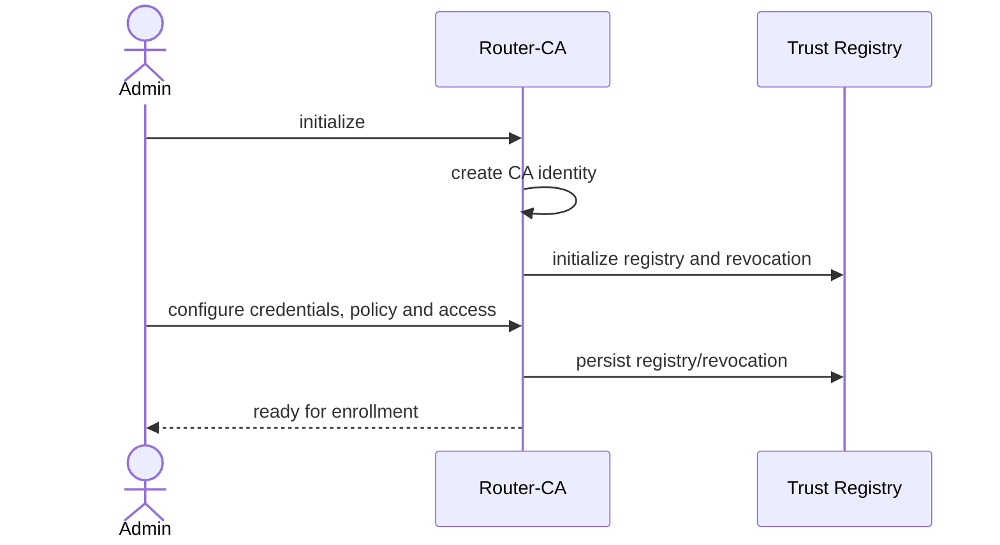
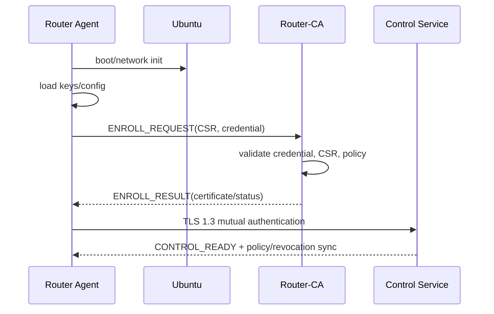
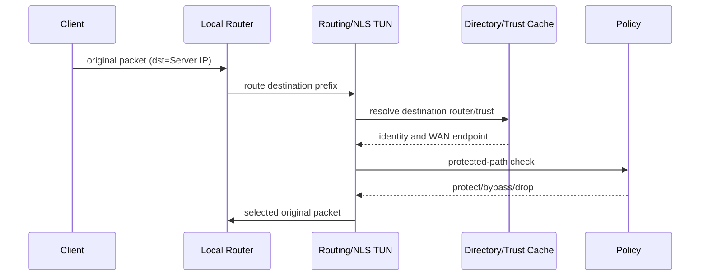
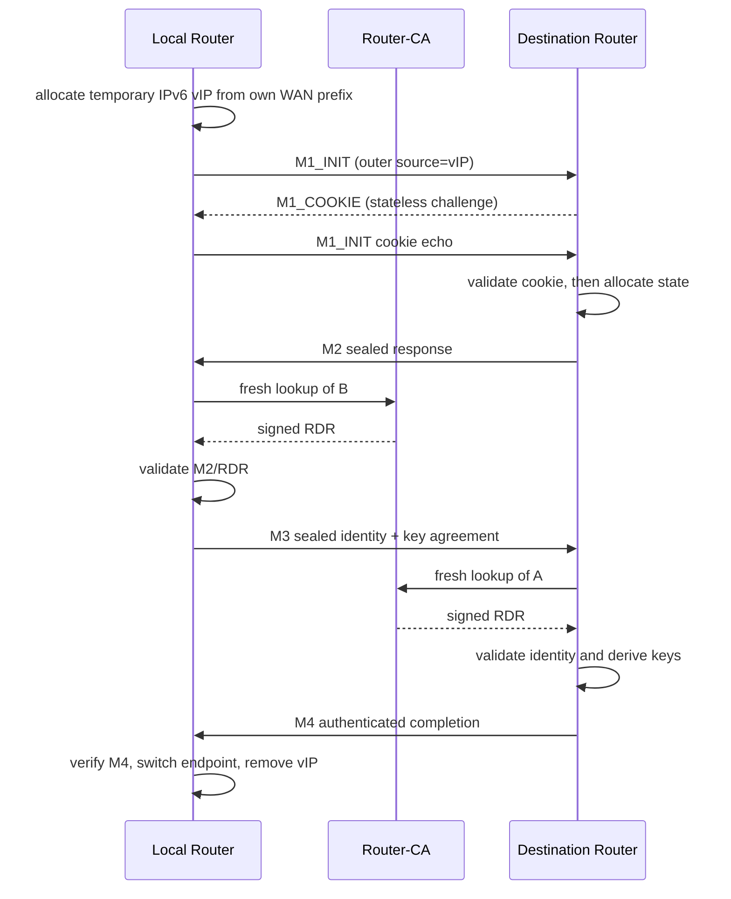
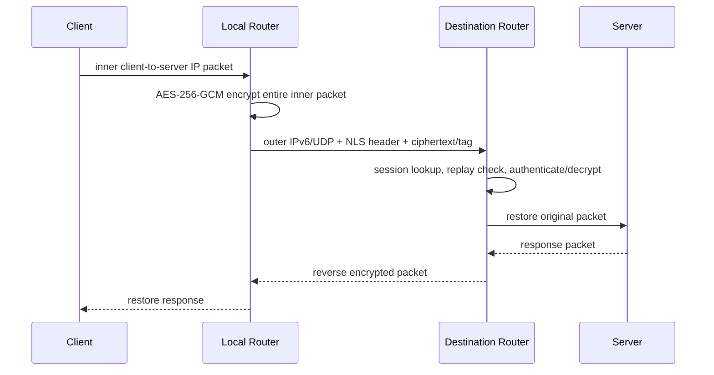
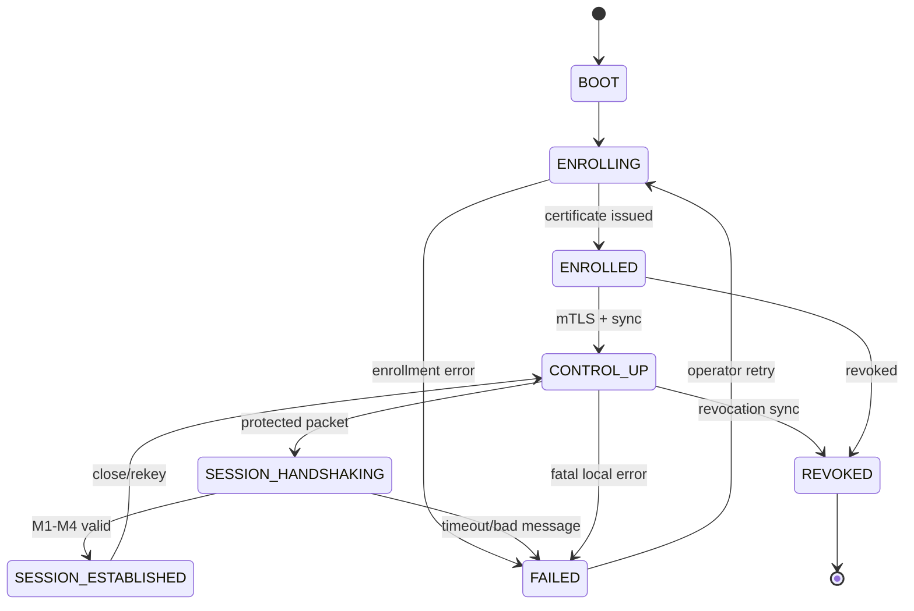

# NLS Architecture v0.1.1

Specification/scaffolding only. Core owns Router-CA, enrollment, trust registry, router directory, policy, revocation, control service and shared `pkg/proto`; NetOS owns the Ubuntu router agent, enrollment client, mTLS client, TUN selection, handshake and data plane. CA signing key never leaves Core; Core never sees user payload; NetOS cannot self-authorize peers.

## Flow 1 — CA init

## Flow 2 — boot/enrollment

## Flow 3 — packet selection

## Flow 4 — handshake

## Flow 5 — data plane

## Router state machine

## Open Questions for owner (ranked)
1. **P0:** compact custom router certificate conflicts with Go TLS's X.509 requirement. Choose X.509 identity or separate X.509 transport identity plus compact NLS identity.
2. **P0:** approve M1 cookie challenge/echo; original diagram shows only one M1.
3. **P0:** finalize M2/M3/M4 transcript order, key derivation and envelope lengths before Step 2.
4. **P0:** confirm 16-byte random router ID and one IPv6+UDP endpoint per RDR.
5. **P1:** approve 300-second RDR TTL and online lookup for each new handshake.
6. **P1:** confirm Linux TUN/policy routing and fail-closed unknown-destination behavior.
7. **P2:** define first-admin bootstrap, CA unlock, backup/restore and HA.
## Ambiguities/contradictions
Cookie defense adds a flight absent from the diagram. Fresh lookup makes CA reachability mandatory for new sessions. vIP requires a routable IPv6 WAN prefix; IPv4-only WAN is unsupported. Full inner-packet encryption hides inner addresses/ports/payload but not outer endpoints, packet sizes or timing.