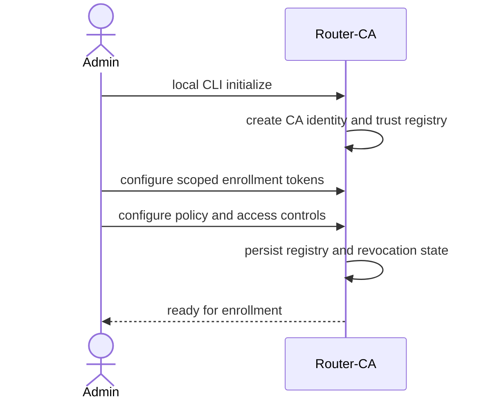
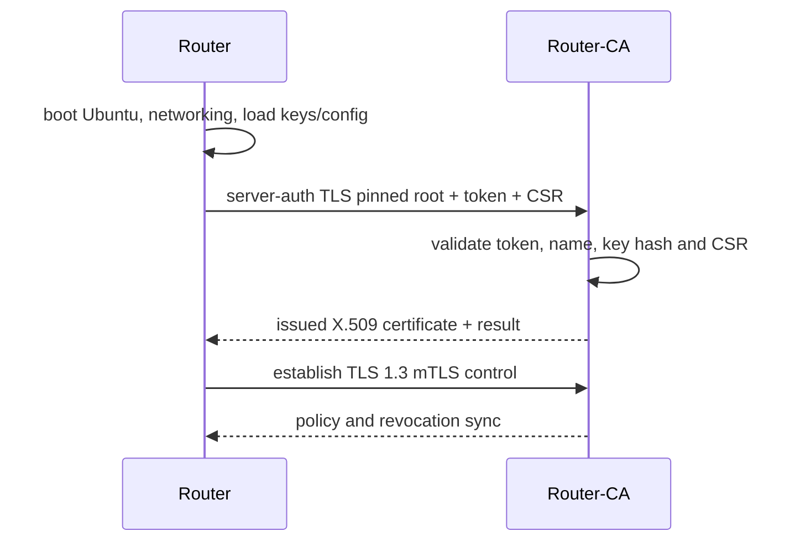
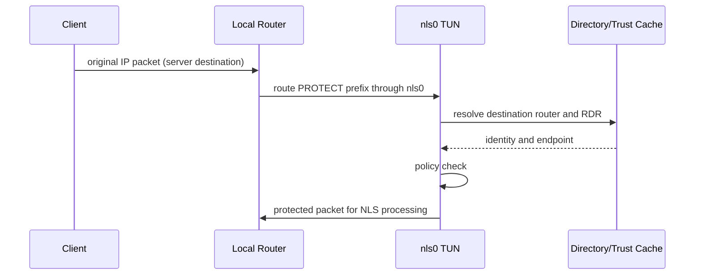
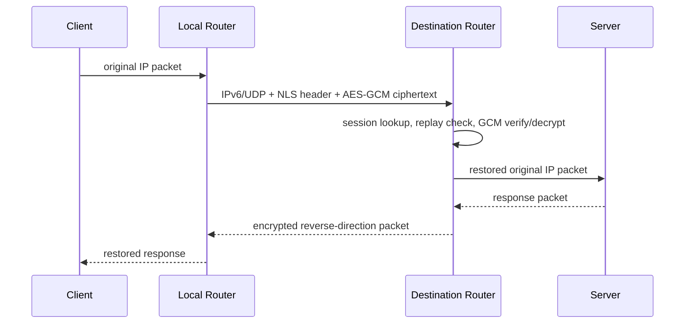
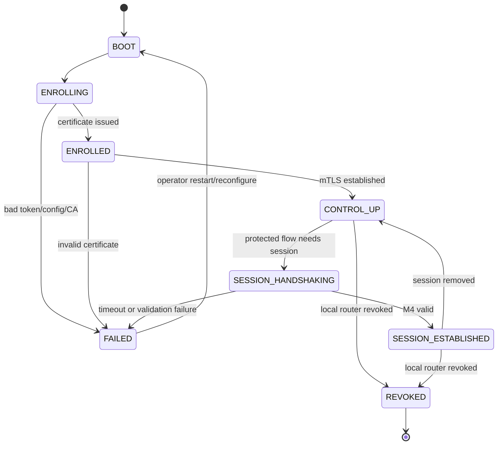

# NLS v0.1.1 Architecture
Status: aligned with frozen PROTOCOL.md, 2026-10-19.

## Repository ownership
- Nls-NexOS-Core-v0.1.1: Router-CA, local admin CLI, enrollment/token service, X.509 issuance for TLS only, RDR registry/signing, directory, policy, revocation, control service and shared pkg/proto.
- Nls-NetOS-v0.1.1: Ubuntu router agent, enrollment client, mTLS control client, nls0 TUN, packet selection, vIP, handshake and encrypted data plane.
- One Ed25519 key per router is the NLS identity; RDR binds router ID, key, endpoint, certificate serial and validity. X.509 is only the TLS control-channel identity; data path does not parse X.509.

## Flow 1 — Router-CA initialization


## Flow 2 — Boot and enrollment


## Flow 3 — Packet selection


## Flow 4 — Handshake
```mermaid
sequenceDiagram
  participant I as Initiator
  participant R as Responder
  participant CA as Router-CA
  I->>R: M1_INIT (outer source=vIP)
  R-->>I: M1_COOKIE (stateless, always)
  I->>R: M1_INIT(cookie)
  R-->>I: M2 (ephemeral, encrypted identity, signature)
  I->>CA: online lookup responder RDR
  I->>R: M3 (encrypted initiator identity, signature)
  R->>CA: online lookup initiator RDR
  R-->>I: M4 (authenticated finish)
  I->>I: switch to real WAN endpoints; remove vIP
```

## Flow 5 — Data plane


## Router state machine


## Handshake state machines
Initiator: IDLE → M1_SENT → COOKIE_RECEIVED → M1_COOKIE_SENT → M2_VALIDATING → M3_SENT → M4_VALIDATING → ESTABLISHED. Every wait has bounded retries; cookie wait 1s, M2/M4 waits 3s, overall 10s. Any malformed frame, bad cookie, stale/revoked RDR, failed signature/tag/transcript or timeout → FAILED and erase tentative keys. vIP removed on success or 10s timeout.
Responder: IDLE → COOKIE_SENT (no state) → COOKIE_VALIDATED → M2_SENT → M3_VALIDATING → M4_SENT → ESTABLISHED. No state before cookie validation. M3 wait 3s; invalid cookie, unknown/revoked source, malformed frame, bad signature/tag/transcript or timeout → drop and erase tentative state.

## Trust boundaries
1. Administrator/local CLI to CA key store.
2. Router to CA enrollment before certificate issuance (pinned server TLS + single-use token).
3. Router-to-CA control plane (TLS 1.3 mTLS).
4. WAN UDP (untrusted; cookie, signatures, AEAD and replay defenses).
5. TUN/kernel boundary (privileged packet input; PROTECT fails closed).
6. Router host filesystem (root-only keys and configuration).

## Open Questions for the owner
See PROTOCOL.md § Objections / Open. CA rotation and multi-node HA are explicitly out of scope for v0.1.1.
